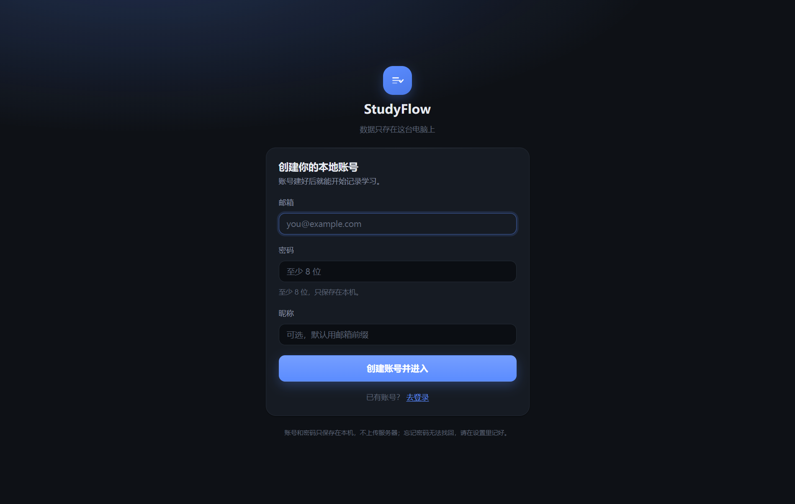
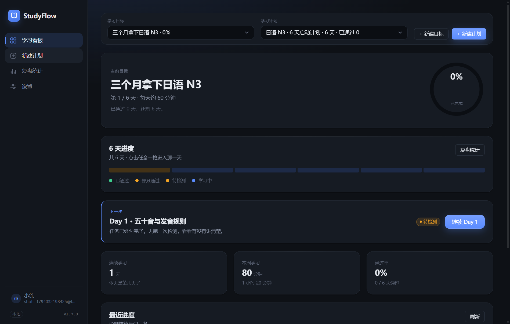
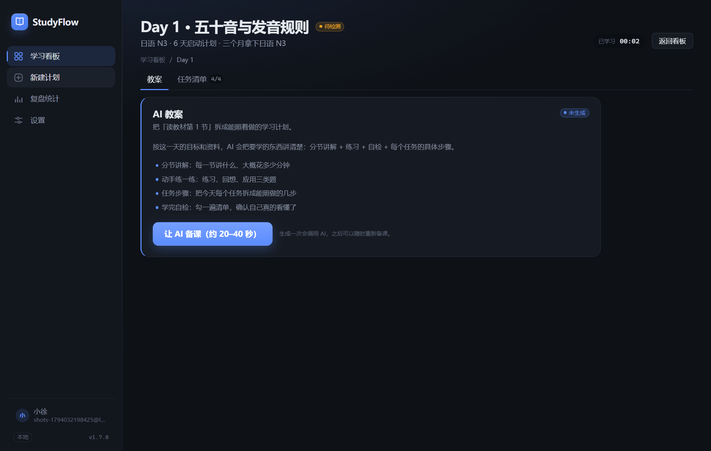
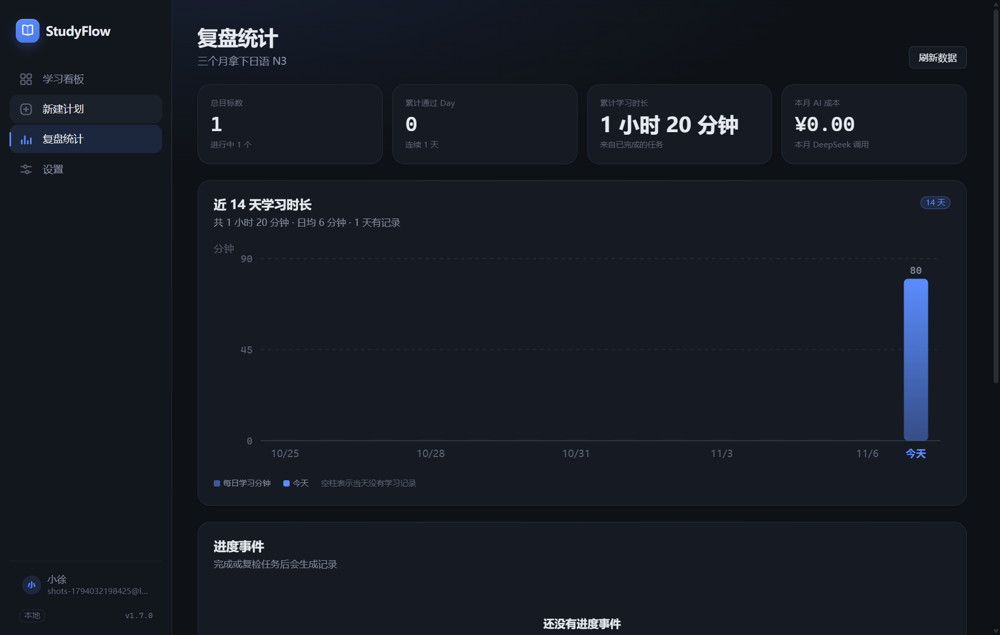
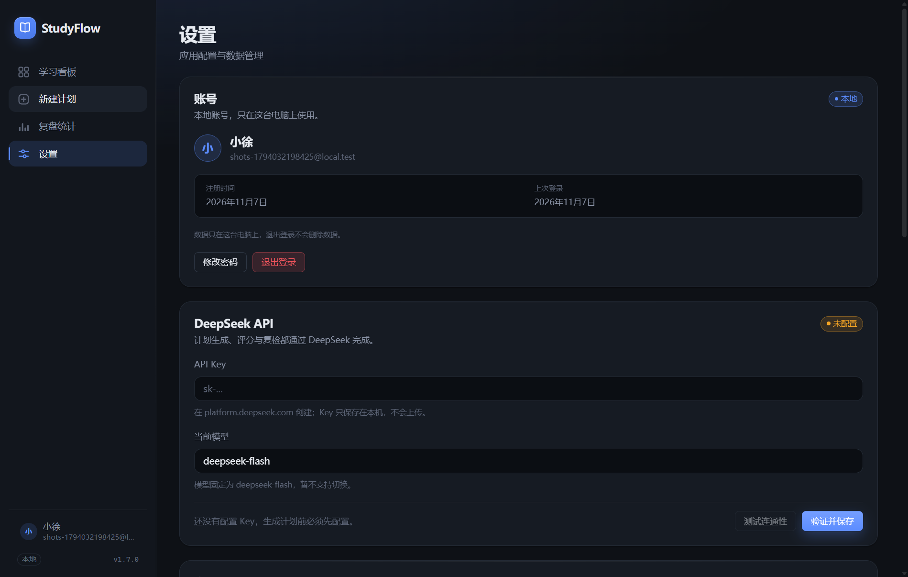
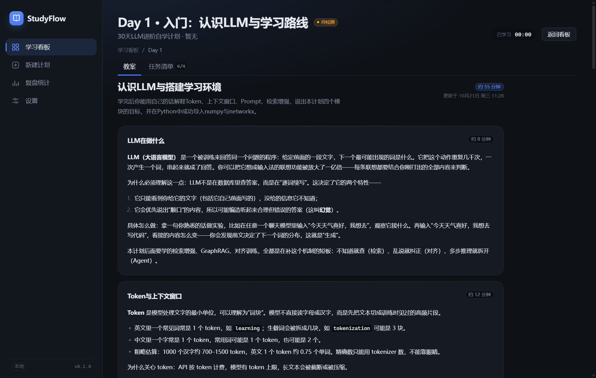
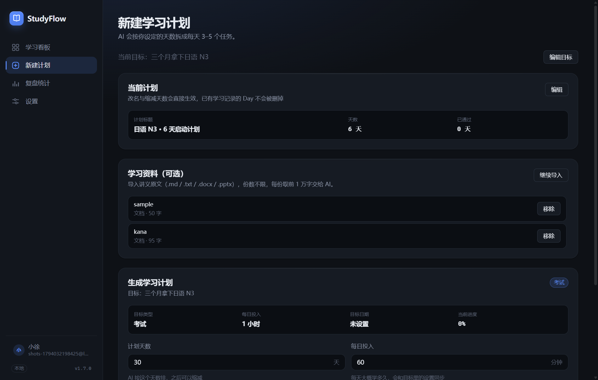
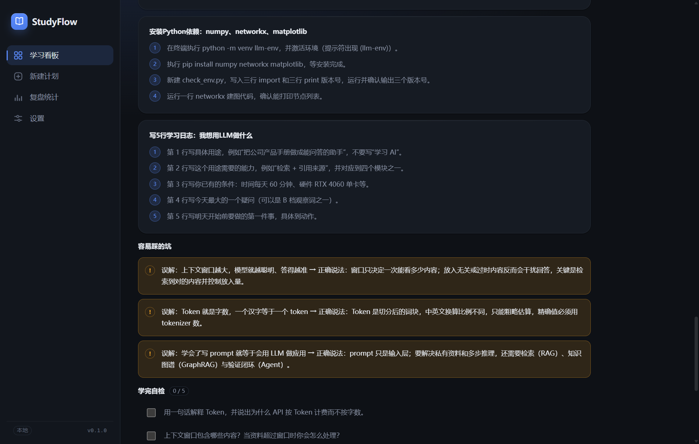
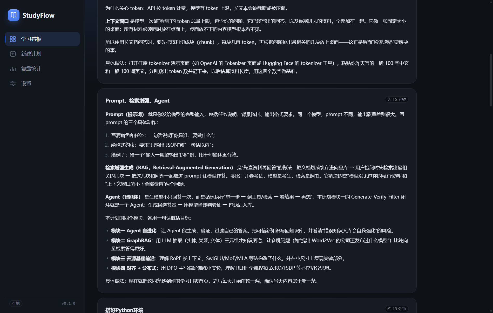

# StudyFlow · AI 监督式学习进度桌面应用

把「我要学 X」变成「今天这几件事做完，进度条就往前走一格」。进度不是自己勾选的，而是**通过考试才算数**。

- 计划：目标 → AI 拆成 30 个 Day，每个 Day ≈ 1 小时，3–5 个可执行任务
- 检测：任意 Day 都能直接发起（7 道单选题各 10 分 + 2 轮问答 30 分，5–10 分钟）；不要求按顺序做，也不要求先勾完任务
- 进度：≥80 分全额通过（进度 +1 格），60–79 只给 60%（可重考），<60 不动
- 复检：在「复盘统计」里随时抽 2 道旧题复查，答错一题**回退** 20%
- 结果页：分数 + 三维得分 + AI 点评（2–4 句）和「最大的漏洞」（1–2 句），文字按句子边界截断，不会出现半句
- 教案：进 Day 后可以「让 AI 备课」，按目标与资料写出分节讲解、练习、每个任务的具体步骤、易错点和自检清单（按天缓存，可重新备课）
- 答疑：教案页底部可以直接提问，AI 对照这一天和你的资料回答
- 账号：本地账号 + 密码登录（只存本机，不联网），每个账号独立数据，退出不删数据
- 资料：可以把 .md / .txt / .docx / .pptx（课堂 PPT，连讲稿备注一起读）教材导进来，生成计划、备课与出题时 AI 会参考原文（份数不限，每份取前 1 万字）
- 多目标：可以同时学多个目标，每个目标有各自的计划、进度、教案和统计，看板顶部一键切换；同一个目标也能存多份计划（旧的自动归档，数据保留）

> 设计文档：`docs/01-产品设计.md`、`docs/02-技术设计.md`、`docs/03-DeepSeek-API-备忘.md`、`docs/04-技术方案.md`、`docs/05-上线路线图.md`（v2 计划：打包/分发/账号同步/AI 网关/商业化）

---

## 技术栈

| 层 | 选型 |
|---|---|
| 壳 | Electron 44 |
| 构建 | electron-vite 6 + Vite 8 + TypeScript 7 |
| 界面 | React 19 + 自研 hash 路由 + 自研 UI 组件 + 原生 CSS 设计令牌 |
| 状态 | Zustand 5 |
| 存储 | SQLite（sql.js WASM，零原生编译），落盘到用户数据目录 |
| AI | DeepSeek `deepseek-flash`（= V4.1-Flash-1017），1M 上下文，不做 RAG |

密钥用 Electron `safeStorage`（Windows 走 DPAPI）加密后存储，只有主进程能解密，渲染进程永远拿不到明文。

---

## 运行

```bash
npm install
npm run dev        # 开发模式（主进程 + 渲染进程热更新）
npm run typecheck  # 主进程 + 渲染进程类型检查
npm run build      # 产物输出到 out/
npm run smoke      # 真实 Electron 冒烟（82 项非 AI 链路检查，失败退出码 1）
npm run dist       # 打包 Windows 安装版 + 便携版（输出到 release/）
npm run dist:dir   # 只出免安装目录 release/win-unpacked/
npm run smoke:packaged  # 对打包后的 exe 再跑一遍冒烟
```

> `npm run dev` / `npm run smoke` 都要求 `ELECTRON_RUN_AS_NODE` 未设置；某些终端（或被其他工具注入的环境）会带着它，导致 Electron 退化成 Node，报 `Cannot read properties of undefined (reading 'isPackaged')`。遇到时先 `Remove-Item Env:ELECTRON_RUN_AS_NODE`。

### 打包 Windows 安装包

```bash
npm run dist     # → release/StudyFlow-<版本>-setup.exe（NSIS 安装版）+ StudyFlow-<版本>-portable.exe（免安装）
```

- 安装版默认**当前用户安装**（不需要管理员），装到 `%LOCALAPPDATA%\Programs\StudyFlow`，自动建桌面与开始菜单快捷方式；卸载默认**保留数据**（`deleteAppDataOnUninstall: false`）。
- 安装包目前**没有代码签名**，Windows 首次运行会弹 SmartScreen「未知发布者」，点「更多信息 → 仍要运行」即可；正式对外分发前需要买证书做签名（见 `docs/05-上线路线图.md` T1.5）。
- 打包依赖的 electron / electron-builder 二进制都走国内镜像（`scripts/dist.mjs` 里已设好环境变量），否则本机直连 GitHub 会超时。

首次启动会进入引导页，要求填写 **DeepSeek API Key**（[platform.deepseek.com](https://platform.deepseek.com) 获取）。Key 只在本机加密保存，没有 Key 时建目标、存计划、勾任务、统计、导出都能正常用，只有 AI 出题/评分会返回 `NO_API_KEY`。

界面截图（`node scripts/smoke.mjs scripts/shots-flow.js .shots` 自动生成，脚本里 `console.log('[shot] <label>')` 即触发主进程截图）：

| 登录 / 创建账号 | 学习看板 |
|---|---|
|  |  |

| 今日 Day（教案 / 任务清单两个 Tab） | 复盘统计 |
|---|---|
|  |  |

| 设置（含账号卡） | 每日教案（AI 备课） |
|---|---|
|  |  |
|---|---|
|  |  |

| 复盘统计 | 设置 |
|---|---|
|  |  |

| 新建计划（手动任务清单 + 资料导入） | 每日教案（AI 备课） |
|---|---|
|  |  |

| 教案：任务步骤与易错点 | 教案：练习与自检 |
|---|---|
|  |  |

---

## 目录结构

```
src/
├─ shared/contracts.ts      # 全局契约：类型 + IPC 通道 + 计分常量
├─ main/auth/service.ts     # 本地账号：scrypt 密码、会话、老数据收编
├─ main/ipc/authHandlers.ts # auth:* 通道（登录/注册/退出/改密码）
├─ main/                    # Electron 主进程
│  ├─ index.ts              # 窗口与生命周期（含 SF_SMOKE 探针）
│  ├─ preload.ts            # contextBridge 白名单
│  ├─ ipc/                  # handle 包装 + 数据类/AI 类通道
│  ├─ db/                   # schema.sql / database.ts(sql.js) / repo.ts
│  └─ ai/                   # DeepSeek client / prompts / 计划 / 教案 / 出题 / 评分 / 问答
└─ renderer/                # React 界面
   ├─ lib/                  # router / api / format
   ├─ store/                # zustand
   ├─ components/           # 设计令牌 + UI 组件库 + 布局 + 复检面板 + 教案面板 + Markdown
   └─ pages/                # 看板 / 今日 / 考试 / 计划 / 统计 / 设置 / 引导
scripts/
├─ smoke.mjs                # 冒烟入口（启动 Electron 并解析结果）
├─ smoke-flow.js            # 注入渲染进程的链路脚本（82 项断言）
├─ shots-flow.js            # 造演示数据 + 逐页打点截图
├─ shots-lesson.js          # 用已备好课的库拍教案截图
└─ fixtures.mjs             # 生成导入测试素材（.md / .docx / .pptx / .pdf）
docs/                       # 产品 / 技术 / API / 方案四份设计文档
```

数据位置：`%APPDATA%\StudyFlow\studyflow.db`（导出文件在 `exports/`）。

---

## 验收状态

已在本机用 `npm run smoke` 实跑（真实 Electron + sql.js 落盘，无 API Key）：

| 项 | 状态 |
|---|---|
| 建目标 → 存计划（3 天 9 任务）→ 首屏数据 | ✅ |
| 勾完任务 → Day 自动 `exam_ready` | ✅ |
| 未配 Key 时 `exam:create` 返回 `NO_API_KEY` | ✅ |
| 新计划所有 Day 直接可学；跳到最后一天也能直接检测（无顺序守卫） | ✅ |
| 进度汇总 / 事件流 / 14 天统计 / Markdown 导出 | ✅ |
| 复检入口可点，无历史考试时给出可读提示 | ✅ |
| 删除目标后不留孤儿数据（统计归零） | ✅ |
| 导入 .md / .docx / .pptx → 解析正文（PPT 带页码与备注）→ 计划页可见、可移除 | ✅ |
| 计划改名 / 缩减天数（Day 跟着减少）/ 加天数被拒并给出原因 | ✅ |
| 生成时可指定计划天数与每日投入，目标可编辑 | ✅ |
| 新建第二个目标 → 自动切换、旧目标数据不受影响 | ✅ |
| 切换目标/计划后 BootstrapData 与今日 Day 同步 | ✅ |
| 删除当前目标后上下文回退到剩余目标 | ✅ |
| 教案：未生成→empty、无 Key 被拦、未备课不能答疑 | ✅ |
| 真实 Key 跑通备课 → 5 节讲解 / 3 道练习 / 4 组任务步骤 / 答疑 | ✅ |
| 冒烟使用独立数据目录（不污染真实库） | ✅ |
| 未登录时数据通道返回 `AUTH_REQUIRED`，界面回到登录页 | ✅ |
| 注册 → 登录态 / 错误密码被拒 / 改密码后旧密码失效 | ✅ |
| 两个账号数据互相看不见（各自一份 `users/<id>/studyflow.db`） | ✅ |
| 首次建号收编登录前的旧库（副本上验证：30 天计划与今日 Day 完整） | ✅ |
| 主题切换（dark/light/跟随系统）实时生效 | ✅ |
| 五个页面渲染无控制台报错、无破图、截图已归档 | ✅ |
| AI 真实链路（生成计划 / 出题 / 问答评分 / 教案 / 答疑） | ✅ 已用真实 Key 跑通（计划 30 天 21s、出题 2.7s、评分 1.0s、教案 5 节 18s / ¥0.013、答疑 1.4s） |

---

## 成本

全部调用 `deepseek-flash`，空闲时段（非工作日 9:00–12:00、14:00–18:00）价格减半：

| 项 | 空闲 | 高峰 |
|---|---|---|
| 输入（缓存未命中） | ¥1 / 百万 tokens | ¥2 |
| 输入（缓存命中） | ¥0.02 / 百万 tokens | ¥0.04 |
| 输出 | ¥4 / 百万 tokens | ¥8 |

一个 30 天的学习目标，全流程约 **¥1–3/月**。教材等稳定内容放在 prompt 前缀，可吃满缓存命中价。

---

## 已知边界

- 账号是「本机账号」：不联网、不跨设备同步；忘记密码无法找回（没有服务器可重置）
- 只支持文字输入（不做语音复述）
- 教案按天生成并缓存：第一次要点「让 AI 备课」，重新备课会再花一次调用（约 ¥0.01–0.02）
- 答疑消息只存在当前页面，刷新即清空（不写入数据库）
- 资料只导入文字：支持 .md / .markdown / .txt / .docx / .pptx；不支持 .ppt（老二进制格式）、PDF、图片、网页；PPT 里纯图片页会被跳过
- 只接入 DeepSeek（不做多模型切换）
- 单机单用户，不做云同步

---

## 版本管理

仓库用 git 管理，主线分支 `main`，发版用语义化版本 tag（当前 `v1.7.0`；历史 tag：`v1.6.0`、`v1.5.0`、`v1.4.0`、`v1.3.2`、`v1.3.0`、`v1.2.0`、`v1.1.0`、`v1.0.0`、`v0.1.0`），每次发版在 [CHANGELOG.md](./CHANGELOG.md) 记一条。

版本约定：`1.x` 都是可用版本，功能新增升次版本号（`1.1.0`），只修 bug 升修订号（`1.1.1`）。

```bash
# 第一次拿到仓库
git init -b main            # 已初始化过则跳过
node scripts/install-git-hooks.mjs   # 安装 pre-commit 钩子（提交前跑 npm run verify）

# 日常：改完一段就提交
npm run verify              # 类型检查 + schema-lint（钩子也会自动跑）
git add -A
git commit -m "feat: 一句话说清这次改了什么"

# 发版（先改 package.json / layout.tsx 的版本号，再提交）
git tag -a v1.4.1 -m "StudyFlow v1.4.1"
git push --tags

# 回看 / 回滚
git log --oneline --decorate
git show v1.3.0            # 看某个版本的完整改动
git revert <commit>        # 撤销某次提交（保留历史）
```

约定：
- `node_modules/`、`out/`、`dist/`、`.tmp-*`、`*.log` 不进仓库（见 `.gitignore`），依赖由 `package-lock.json` 锁定。
- **API Key 存在本机 `%APPDATA%\StudyFlow`，不属于仓库内容**；提交前钩子 + `.gitignore` 都不会带上它。
- `.shots/` 里的界面截图会入库，README 才能直接显示；改版式后重新 `node scripts/smoke.mjs scripts/shots-flow.js .shots` 覆盖即可。

推送到远端（GitHub / Gitee 都行，需要先建空仓库）：

```bash
git remote add origin https://github.com/<你的账号>/studyflow.git
git push -u origin main
git push --tags
```

test

